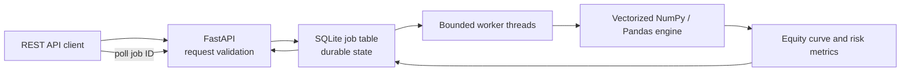

# Algorithmic Trading Backtester

A vectorized long/cash moving-average crossover engine exposed through an
asynchronous FastAPI job API. Submitted jobs are persisted to SQLite and
processed by a bounded worker pool. The service is intended as a clear,
reproducible systems portfolio project, not as investment advice or a
production order-execution system.

## Architecture



## Layout

```text
trading-backtester/
├── trading/
│   ├── api.py             # Submit and poll job endpoints
│   ├── engine.py          # Vectorized strategy and performance metrics
│   └── job_manager.py     # SQLite persistence and worker pool
├── tests/
│   └── test_engine.py
├── Dockerfile
├── render.yaml
├── requirements.txt
└── README.md
```

## Strategy and accounting conventions

- Uses close-only prices and a long-or-cash moving-average crossover.
- The fast and slow simple moving averages are calculated with Pandas rolling
  windows. A close-derived signal is shifted by one bar before exposure is
  applied, avoiding same-bar look-ahead.
- Commission and slippage are configurable in basis points and charged on
  changes in exposure.
- Includes total return, CAGR, annualized volatility, Sharpe ratio, maximum
  drawdown, trade count, market exposure, and the full equity curve.
- Defaults to 252 periods per year. For intraday or non-daily data, set
  `periods_per_year` to the appropriate annualization convention.

The model does not include dividends, corporate actions, borrow costs, funding,
market impact beyond configured slippage, taxes, partial fills, or exchange
calendar handling. Results are sensitive to data quality and assumptions.

## Run locally

```powershell
cd projects/trading-backtester
py -3.11 -m venv .venv
.\.venv\Scripts\Activate.ps1
python -m pip install -r requirements.txt
uvicorn trading.api:app --host 0.0.0.0 --port 8000
```

Submit an asynchronous job with chronological ISO-8601 timestamps and close
prices:

```powershell
curl.exe -X POST http://localhost:8000/api/v1/backtests `
  -H "Content-Type: application/json" `
  -d '{\"config\":{\"fast_window\":5,\"slow_window\":20,\"initial_cash\":100000,\"commission_bps\":1,\"slippage_bps\":1,\"periods_per_year\":252},\"bars\":[{\"timestamp\":\"2025-01-01T00:00:00Z\",\"close\":100},{\"timestamp\":\"2025-01-02T00:00:00Z\",\"close\":101},{\"timestamp\":\"2025-01-03T00:00:00Z\",\"close\":99}]}'
```

Poll `GET /api/v1/backtests/{job_id}` until the status is `succeeded` or
`failed`. A completed job response includes metrics, an equity curve, or a
sanitized error message. At least `slow_window + 1` bars are required by the
engine, so increase the sample in a real request.

## Configuration

| Variable | Default | Description |
|---|---|---|
| `BACKTEST_DB` | `./data/backtests.sqlite3` | SQLite job database |
| `BACKTEST_WORKERS` | `2` | Number of concurrent worker threads per API process |
| `MAX_PENDING_JOBS` | `1000` | Admission cap for queued and running jobs |

SQLite uses WAL mode and recovers interrupted `running` jobs to `queued` on
startup. Mount a persistent writable volume at `/data` in Docker. Run one API
replica per SQLite database; horizontal scaling requires an external
transactional queue and shared result store.

The sample service stores submitted price series and results in SQLite without
encryption. Use synthetic/public market data for local demonstrations. A
production service handling restricted data should add access control,
encryption at rest, retention limits, and audit logging.

## Docker

```powershell
docker build -t trading-backtester .
docker run --rm -p 8000:8000 -v backtest-data:/data trading-backtester
```

The container runs as a non-root user and persists job state under `/data`.

## Free deployment on Render

The repository includes a Render Blueprint in `render.yaml`. To create the
service without installing a cloud CLI:

1. Sign in to [Render](https://dashboard.render.com/).
2. Select **New + → Blueprint** and connect the
   `HarshitGaur08/trading-backtester` GitHub repository.
3. Review the `trading-backtester` service, confirm the **Free** plan, and
   create the service.
4. After the first deploy, open the service URL and check `/health/ready` or
   `/docs`.

The free web service sleeps after inactivity and can take time to wake up. Its
filesystem is ephemeral; this configuration stores SQLite data under `/tmp`,
so jobs, results, and queued work can disappear when the service sleeps,
restarts, or redeploys. Use this deployment for demonstrations with
non-sensitive data, not durable workloads. Render's free-plan quotas and
availability can change; check its current
[free-instance limits](https://render.com/docs/free) before deploying. Staying
within free limits is required to avoid charges.

## Performance and benchmarking

The strategy calculations are vectorized and scale approximately linearly with
the number of bars; API validation and returning a full equity curve add
serialization and response overhead. No hardware-independent performance
figures are asserted. To measure this environment, time `run_backtest` against
representative datasets and report dataset size, hardware, Python/NumPy/Pandas
versions, warm-up policy, and repeated-run median. Do not compare results unless
those conditions are disclosed.

## API and errors

| Method | Path | Behavior |
|---|---|---|
| `GET` | `/health/live` | Liveness |
| `GET` | `/health/ready` | Readiness while worker pool is active |
| `POST` | `/api/v1/backtests` | Validate input, persist job, return `202` and job ID |
| `GET` | `/api/v1/backtests/{job_id}` | Get status and terminal result |
| `GET` | `/docs` | OpenAPI documentation |

Requests support up to 100,000 bars. Invalid prices, out-of-order or duplicate
timestamps, full queues, missing jobs, and execution failures return explicit
HTTP status or terminal job errors.

## Tests

```powershell
python -m pip install -r requirements-dev.txt
python -m pytest -q
```
